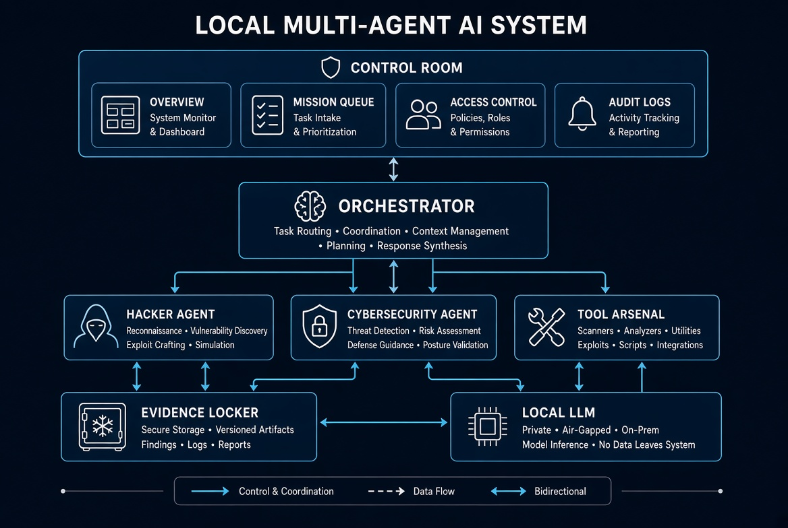
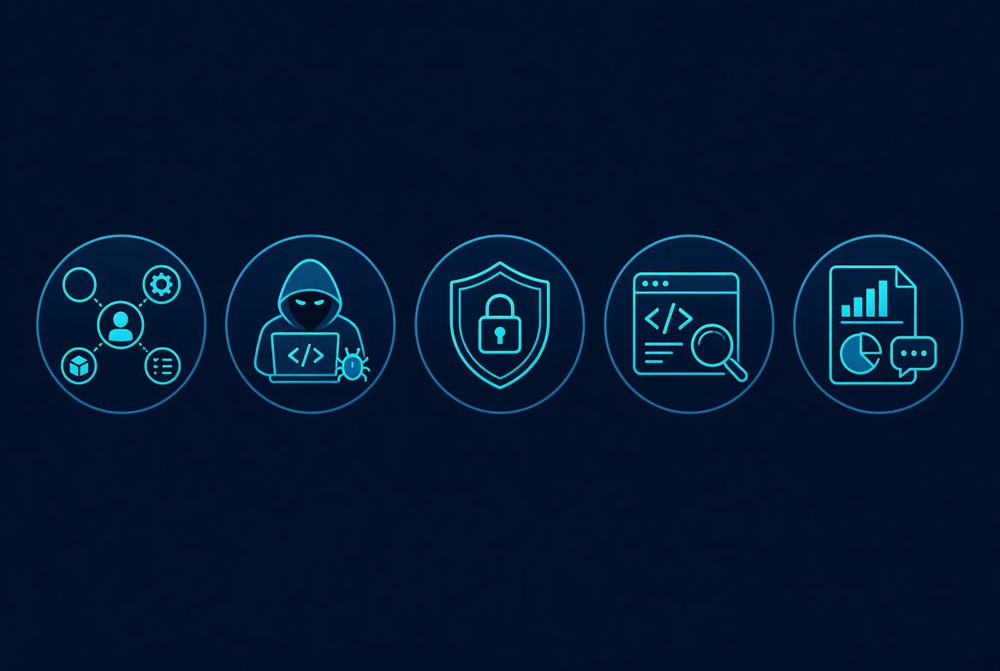
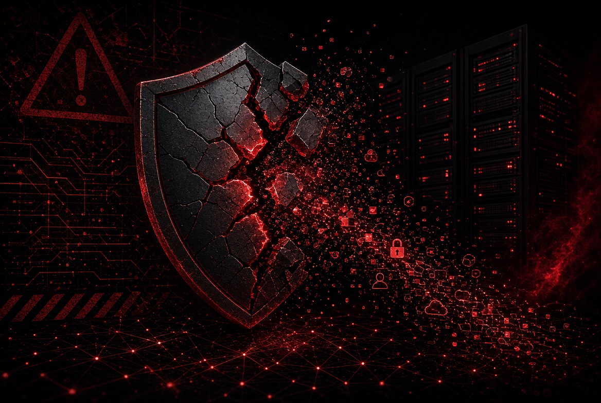

<p align="center">
  
</p>

<h1 align="center">Kevinos-SI-Qwen3.8-27B-Uncensored-Hack</h1>
<p align="center">
  <strong>Local Multi-Agent AI Control Room — Autonomous Cybersecurity & Hacker Engine</strong>
</p>

<p align="center">
  <a href="#features"></a>
  <a href="#hacker-role-deep-dive"></a>
  <a href="#cybersecurity-role-deep-dive"></a>
  <a href="#source-release-challenge"></a>
  
</p>

<p align="center">
  Created by <strong>Bussens Kévin</strong><br>
  <a href="mailto:bussenskevin@gmail.com">bussenskevin@gmail.com</a> · 
  GitHub: <a href="https://github.com/ar51kevinos">@ar51kevinos</a> · 
  X: <a href="https://x.com/bussenskevin93">@bussenskevin93</a>
</p>

---

> **Official name:** Kevinos-SI-Qwen3.8-27B-Uncensored-Hack  
> **Version:** 2.0.0 (Autonomy & Self-Correction)  
> **Python package:** `kevinos_si`  
> **User config:** `~/.kevinos-si`  
> **Default UI:** `http://127.0.0.1:7860`  
> **Intended use:** Authorized security testing and research only

---

## Source Release Challenge

**The full source code of this project will be released publicly and free only if this repository reaches 1,000 stars before January 1, 2027.**

Until that goal is reached, the complete source remains restricted.  
This is a public challenge: star the repository, share it, and help the project cross 1,000 stars before the deadline.

If the target is met, the full source will be made available under an open license.

---

## What is Kevinos-SI?

Kevinos-SI is a **local multi-agent AI operating system** that runs entirely on your machine. It connects an uncensored local large language model (via LM Studio or any OpenAI-compatible endpoint) to real tools: files, terminal, browser, scanners, and specialized agents.

Unlike cloud chatbots, Kevinos-SI can:

- Plan and execute multi-step missions
- Coordinate specialized agents (orchestrator, hacker, cybersecurity, code review, QA, reporting…)
- Use real system tools under controlled policies
- Persist across missions with structured memory and lessons
- Generate evidence-backed security findings
- Operate in **Full PC** mode (user-level Windows permissions) when explicitly enabled
- Self-correct by storing and reinjecting lessons from previous missions

It is built for **authorized use only** (localhost, Owned Targets, trusted operator-launched missions).

<p align="center">
  
</p>

---

## Features

### Core Capabilities
- Local LLM integration (LM Studio / OpenAI-compatible)
- Bootstrap Control Room web interface
- Multi-agent orchestration with role contracts
- Autonomous mission engine (understand → plan → execute → observe → correct → continue)
- Structured memory (lessons, target memory, recipes)
- Self-improvement via local lesson reinjection (no neural weight training claimed)
- Evidence Locker + QA honesty (no fake “confirmed” vulnerabilities)
- Anti-hijacking protection (external web content is treated as data only)
- Full PC mode with agent inheritance
- Ownership modes: strict / trusted / off
- Owned Targets registry
- Tool Arsenal with fallback chain (native → install → research → script synthesis → unavailable)
- Dynamic playbook generation
- Custom script / PoC synthesis for authorized targets
- Audit logging and stop reasons
- Gradio legacy UI (optional)

### Autonomy & Self-Correction (2.0.0)
- Lessons written at mission end and reinjected into future similar missions
- Policy-lock filter prevents learned text from disabling anti-hijack, ownership, or Full PC
- Repeated failures trigger strategy shifts and dynamic playbooks
- Explicit `stop_reason` on every mission
- Role contracts (mission, success criteria, tools, handoffs)
- Control Room board shows modes, budgets, timeline, scripts, playbooks, missing tools, stop reason, target memory, and lessons

### Hacker Impossible Engine & Full Hacker Mode
- Aggressive authorized offensive pipeline
- Versioned web attack playbooks
- Internal pure-Python response-diff fuzzer
- Multi-signal correlation
- Target memory per authorized domain
- Script synthesis when tools are missing
- Dynamic playbook creation
- High but finite budgets under Full Hacker / Hacker Max
- No moral refusal on authorized scope

### Cybersecurity Role
- Blue-team validation of findings
- Remediation guidance
- Configuration and log review
- Collaboration with hacker and QA
- Cannot unilaterally mark findings as confirmed (QA gate)

---

## Roles Overview

<p align="center">
  
</p>

| Role | Mission | What it can really do |
|------|---------|-----------------------|
| **GOD / Orchestrator** | Top-level coordination | Routes intent, selects agents, merges results, enforces mission scope |
| **cyber_orchestrator** | Cyber mission lead | Plans security missions, verifies authorized scope, coordinates specialists |
| **hacker** | Authorized offensive specialist | Surface mapping, playbooks, fuzzer, script synthesis, evidence collection on authorized targets |
| **red_team** | Attack path analysis | Chains weaknesses on authorized systems, proposes scenarios |
| **cybersecurity** | Blue team | Validates findings, proposes fixes, reviews configs and logs |
| **web_security** | Web/API specialist | SQLi, XSS, sessions, headers, secrets on authorized apps |
| **linux_security / windows_security** | OS review | Configuration and hardening checks (read-only first) |
| **code_review / vulnerability_analyst** | Source analysis | Static review of provided code, sink mapping |
| **qa_security** | Quality gate | Only role that can accept `confirmed` findings; rejects evidence-less claims |
| **reporting** | Final output | Structured reports with taxonomy (confirmed / probable / needs_investigation / theoretical) |

Role contracts define measurable handoffs. Contracts never override ownership, anti-hijack, or Full PC policies.

---

## Hacker Role — Deep Dive

The **hacker** role is the authorized offensive specialist of Kevinos-SI. It is not a generic chatbot. It is designed to pursue security weaknesses on systems the operator owns or is explicitly authorized to test.

### When it activates
Orders containing language such as “hack my site”, “scan”, “audit”, “find vulnerabilities”, “PHP”, “SQL”, “SQLi”, “XSS”, “SSH”, “fix”, etc., are auto-routed to the cyber/hacker pipeline when Full Hacker / Hacker Max is enabled.

### What it does on an authorized target
1. **Understand** the objective and verify scope (localhost / Owned Target / trusted launch).
2. **Recon & fingerprint** technologies, headers, forms, paths, cookies.
3. **Map the attack surface** (parameters, endpoints, sensitive paths).
4. **Select or generate playbooks** (recon, SQLi error/blind, XSS, auth, IDOR, upload, session/JWT, sensitive files, code+live correlation).
5. **Ensure tools** via the fallback chain:
   - Native tool on PATH
   - Allowlisted install
   - Research proposal
   - Mission-local script synthesis
   - Honest “unavailable”
6. **Test hypotheses** with playbooks, internal fuzzer, or custom scripts.
7. **Correlate signals** (fingerprint, headers, errors, diffs, tool output, source clues).
8. **Collect evidence** in the Evidence Locker.
9. **Hand off** to cybersecurity and QA.
10. **Report** with taxonomy and stop reason.

### Playbooks (versioned)
Examples of structured playbooks present in the system:
- Surface recon & technology fingerprint
- Content discovery
- Security headers / TLS
- Reflected XSS probe
- Error-based and blind SQLi probes
- Auth bypass / weak controls
- IDOR
- Mass assignment
- File upload checks
- Session / JWT basic checks
- Sensitive file exposure
- Code + live correlation (when source is available)

The hacker can also generate a temporary playbook on the fly when no existing one fits, and store successful recipes for similar future targets.

### Internal fuzzer
When external tools (sqlmap, nuclei, ffuf) are missing or stuck, a pure-Python response-diff fuzzer mutates parameters and compares status, length, timing, and error signatures. Interesting diffs can be promoted as evidence candidates.

### Custom script synthesis
If a capability is unavailable:
- The system can generate a mission-local Python / PowerShell / Bash script
- Scripts are saved under `workspace/missions/<id>/scripts/` with metadata
- Execution happens under Full PC policy and is audited
- Output is captured as evidence
- Iteration is bounded by script budgets

### Persistence (“try the impossible”)
On authorized scope the hacker does not morally refuse. It continues until:
- Evidence is found, or
- Budgets are exhausted, or
- The user cancels, or
- A true hard limitation is reached, or
- The target is unauthorized under strict ownership

### What the hacker cannot do
- Magically gain SSH access without credentials you provide
- Guarantee finding every vulnerability
- Replace commercial DAST tools or a full Kali distribution
- Test unauthorized third-party systems in strict ownership mode
- Disable anti-hijack or ownership via learned content
- Fabricate confirmed vulnerabilities without proof
- Run unrestricted webshell / OS-shell / ransomware modules (blocked by design)

`sqlmap` (when present) is gated: Full PC + authorized target + `authorized_exploitation_enabled` + detection-only arguments (no `--dump`, no `--os-shell`).

---

## Cybersecurity Role — Deep Dive

The **cybersecurity** role is the blue-team counterpart. It does not “hack”. It validates, challenges, and proposes fixes.

### What it can do
- Review findings produced by the hacker
- Examine configurations and logs when access is provided
- Propose concrete remediations (headers, input validation, prepared statements, auth checks, etc.)
- Coordinate with QA and reporting
- Assist in verify-after-fix loops when requested
- Flag false positives or incomplete evidence

### What it cannot do
- Guarantee that a system is secure
- Unilaterally mark a finding as `confirmed` (QA is the gate)
- Override ownership or anti-hijack policies
- Magically fix remote systems without authorized access and credentials
- Replace a human security engineer

An LLM-based blue team can produce false positives, false negatives, and incomplete fixes. Human review remains essential.

### Collaboration with the hacker
Typical pipeline:
`cyber_orchestrator` → `hacker` / `web_security` / `red_team` → `vulnerability_analyst` → `cybersecurity` → `qa_security` → `reporting`

The hacker leads offense on authorized targets. Cybersecurity validates and guides remediation. QA blocks evidence-less “confirmed” claims.

---

## Modes

| Mode | Description | Risk |
|------|-------------|------|
| **Safe** | Actions primarily limited to project workspace | Lower |
| **Full PC** | Tools run with current Windows user rights | High — not a sandbox |
| **ownership strict** | Public domains require Owned Targets entry | Recommended default |
| **ownership trusted** | User-launched targets treated as authorized (still audited) | Operator responsibility |
| **ownership off** | Minimal prompts (loud warning) | Very high |
| **Hacker Max / Full Hacker** | Higher budgets, fewer confirms, aggressive persistence on authorized targets | High on authorized systems |
| **authorized_exploitation** | Opt-in for active PoC steps | High |

Budgets (tool calls, minutes, scripts, strategy shifts) are finite technical limits. They are free and local — not a paid service.

---

## Installation (Windows 11)

1. Install **Python 3.11 or 3.12** from [python.org](https://www.python.org/downloads/windows/) with “Add Python to PATH”.
2. Install **LM Studio**, load a compatible model, and start the local OpenAI-compatible server (default port 1234).
3. Extract the project archive.
4. Run `install.bat` (creates `.venv` and installs dependencies).
5. Run `run.bat`.
6. Open `http://127.0.0.1:7860`.
7. Check Diagnostic, add Owned Targets, and enable Full PC / Full Hacker only after understanding the risks.

---

## Risks, Dangers & Worst-Case Scenarios

<p align="center">
  
</p>

### Operator misuse (even on authorized systems)
- Aggressive scanning or fuzzing can degrade or temporarily take down a site.
- Custom scripts or active exploitation can modify data or files.
- Full PC can delete or alter important files outside the workspace.
- SSH sessions with provided credentials can run destructive commands.
- False positives can lead to unnecessary or harmful changes.
- Secrets in the workspace can be read by agents.
- Resource exhaustion (CPU/RAM) if budgets are set extremely high.

### If the source falls into the wrong hands
- An attacker could strip Owned Targets and ownership checks to scan unauthorized systems.
- Anti-hijack could be disabled, making the agent easier to manipulate via malicious web content.
- Budgets could be removed for mass scanning.
- The project could be modified and redistributed under the original author’s name.
- Custom script synthesis could be weaponized for unauthorized exploitation.
- Combined with Full PC on a victim machine, it could assist in local compromise or data theft.
- Learned recipes and playbooks could be reused against unintended targets.

### Catastrophic combinations
- Full PC + ownership off + disabled anti-hijack + no Evidence QA = high risk of uncontrolled actions and false confidence.
- Malicious webpage content + weak injection defenses = potential mission hijacking.
- Leaked secrets + network tools = credential exposure.
- Persistent processes + no stop mechanism = resource exhaustion or repeated unintended actions.
- Hacker + cybersecurity disagreement with no QA gate = conflicting or dangerous remediation.
- Custom script generation + Full PC + no audit = hard-to-trace local changes.

These scenarios are why the project ships with strict ownership by default, anti-hijack, Evidence Locker, finite budgets, and explicit operator responsibility.

---

## Security Boundaries (Kept by Design)

- External web content is wrapped as untrusted data
- Suspicious override phrases are detected and logged
- Confirmed findings require evidence
- No mass internet scanning feature
- No malware builder, ransomware, or UAC bypass modules
- Unauthorized third-party targeting blocked in strict mode
- Learned lessons cannot rewrite safety policies
- Operator is solely responsible for legal compliance and ownership claims

---

## Project Structure (High Level)

```
main.py                 # Launcher
src/kevinos_si/         # Core package
  core/                 # Agents, tools, missions, playbooks, fuzzer, anti-hijack, evidence, self-improve
  gui/                  # Interfaces
  memory/               # Memory layers
  webapp.py             # Control Room (FastAPI + Bootstrap)
tests/                  # Automated tests
docs/                   # Documentation
install.bat / run.bat   # Windows helpers
```

---

## Author

| | |
|---|---|
| **Name** | Bussens Kévin |
| **Email** | bussenskevin@gmail.com |
| **GitHub** | [@ar51kevinos](https://github.com/ar51kevinos) |
| **X** | [@bussenskevin93](https://x.com/bussenskevin93) |
| **Project** | Kevinos-SI-Qwen3.8-27B-Uncensored-Hack |

---

## Legal & Disclaimer

This software is provided for **authorized security testing and research only**.  
Unauthorized use against systems you do not own or have explicit permission to test may be illegal.

**Bussens Kévin (@ar51kevinos) is not responsible for illegal use, data loss, or damage resulting from the use of this project.**  
The operator is solely responsible for compliance with applicable laws and for obtaining necessary authorizations.

---

## License & Source Availability

Until the **1,000-star challenge** is completed (before January 1, 2027), the full source code is not publicly released.  
If the repository reaches 1,000 stars before that date, the complete source will be made freely available.

---

<p align="center">
  <strong>Kevinos-SI 2.0.0</strong> — Local Multi-Agent AI Control Room<br>
  Built by Bussens Kévin · @ar51kevinos · @bussenskevin93
</p>
